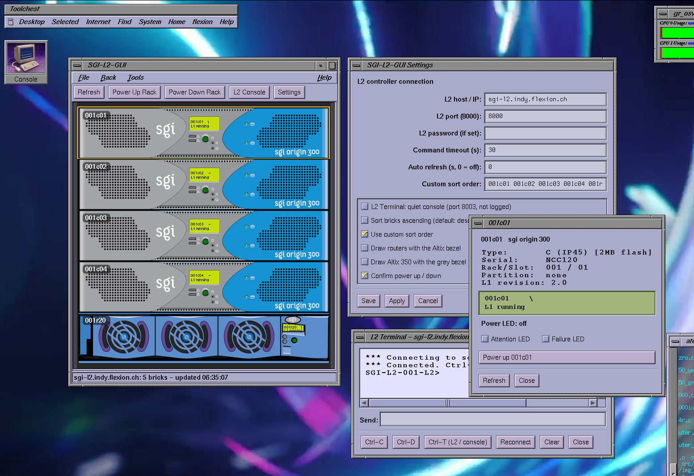
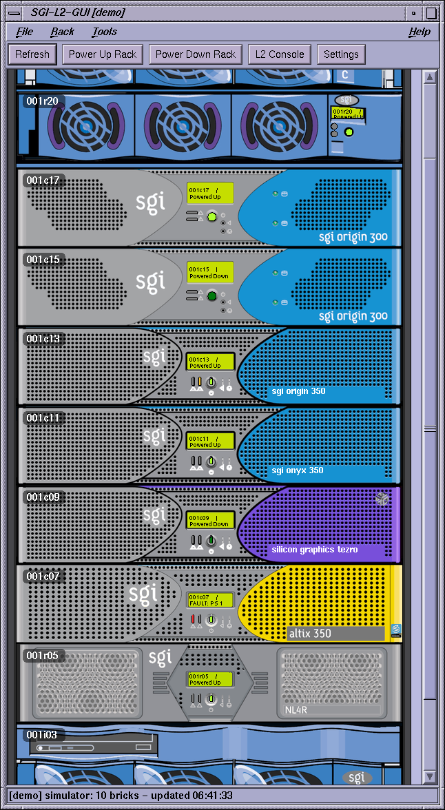

# SGI L2 Controller GUI for IRIX

Based on [SGI-L2-WUI](https://github.com/flexion-unity/SGI-L2-WUI) by flexion, chulofiasco and nater1217.

`sgil2gui` is a native IRIX 6.5 / Motif application for the SGI L2 system controller. 

* talks to your L2 controller directly over its own protocol (TCP 8000, as SGI's `l2cmd` does)
* renders the server rack inventory in the GUI
* shows LCD text, power / attention / failure LEDs of every brick
* power up / down the whole rack or single bricks
* L2 console, rack config info, environment summary, fan status
* custom brick sort order to match your physical rack



Supported bricks: Origin 300, Origin 350, Onyx 350,
Tezro (rackmount), Altix 350 (yellow or grey bezel), Altix 3000 C-brick, Altix 3000 iX-brick, NL4R, router (Origin or Altix style).



* Click a brick to open its dialog: LCD, details, Attention / Failure LED switches, power button.
* **Rack** menu / toolbar: refresh, power the whole rack up / down, env summary, fan status, router info.
* **Tools > L2 Console** (Ctrl+L): send L2 commands
* **Tools > L2 Terminal**: the L2's raw console port (8001, or 8003 "quiet" whose sessions the L2 does not log)

## Connection

Connects to the L2's command port 8000, speaking SGI's Router / IRouter protocol like `l2cmd`. Supports an L2 password (`l2passwd`).

The direct protocol was ported from nater1217's implementation of the direct connection mode in SGI-L2-WUI, replacing telnet connection mode.


## Build and install (IRIX)

```sh
make
make install    # as root: /usr/local/bin/sgil2gui + app-defaults
```

`make install` copies `app-defaults/SgiL2Gui` to `/usr/lib/X11/app-defaults`.


## Usage

```sh
sgil2gui                                 # launch GUI. uses ~/.sgil2guirc

sgil2gui -host 192.168.0.100             # override the L2 host
sgil2gui -host l2 -password secret       # an L2 with a password
sgil2gui -host l2 -cmd "config"          # one command, printed, no X
sgil2gui -host l2 -summary               # parsed rack summary, no X
sgil2gui -demo                           # built-in L2 simulator, no hardware
```

On first start without a configured host the Settings dialog opens.
Save writes config to: `~/.sgil2guirc` (mode 600, as it may hold the L2 password). See `sgil2guirc.sample`.
